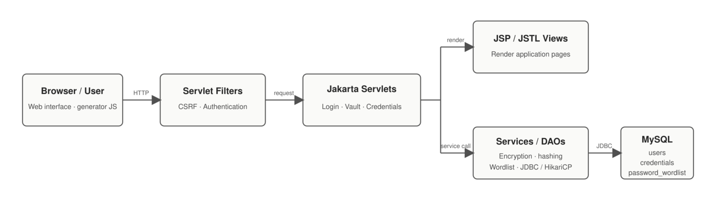

# VAULTIFY
## Secure Personal Credential Manager
### Quiz 2 Report

EF234301 Web Programming (D)  
Academic Year 2026/2027

**Group Members**

- Yulius Restu Putranto – 5025251042
- Dimas Adyaksa – 5025251107
- Fathan –

Repository: https://github.com/dimas-ady/EF234301_WebPro_Q2  
Deployment: https://vaultify.adiyaksaa.my.id

## 1. Introduction

Vaultify is a personal credential manager implemented with Java 17 and Jakarta Server Pages. This version is a rewrite of the earlier Laravel application, reimplemented to meet the JSP-based project requirements. It allows users to register and sign in, store and manage service credentials, search and filter their vault, mark credentials as favorites, reveal stored passwords on request, and generate passwords.

The application uses MySQL for data persistence. Credential passwords and notes are encrypted before storage, while account passwords are hashed. Vaultify is packaged as a WAR and runs on Apache Tomcat.

## 2. Design

### 2.1 Design Concept

The design prioritizes clear credential management and deliberate access to sensitive information. Passwords are hidden by default and revealed only through an explicit user action. The vault provides search and favorites filters, while create and edit forms let users manage credential records.

The password generator provides controls for password length and character sets. Passwords are generated in the browser and are not sent to or stored by the server.

### 2.2 System Architecture

Vaultify uses a servlet-based web architecture. Jakarta Servlets handle HTTP requests, validation, and application workflows. JSP and JSTL render the interface. DAO classes use JDBC to access MySQL, and HikariCP manages database connections. Separate classes provide password hashing, credential encryption, login rate limiting, and wordlist operations.

On startup, the application loads its configuration, initializes the database connection, creates the schema if needed, and registers the application context. The project is packaged as a WAR and deployed to a Tomcat 10.1 container.

*Figure 1. Vaultify application architecture.*

### 2.3 Conceptual Data Model

The core data model contains users, credentials, and password wordlist entries. One user can own multiple credentials, while each credential belongs to one user. The wordlist is used to check whether a credential password matches a known entry.

**Figure 2. Vaultify conceptual data model.**  
*[Retain the corresponding conceptual data model image from the original report here.]*

### 2.4 Physical Data Model

| Table | Column | Type / Constraint | Purpose |
|---|---|---|---|
| `users` | `id` | `BIGINT UNSIGNED`, primary key | Identifies a user. |
| `users` | `name`, `email` | `VARCHAR(255)`; email unique | Stores user identity and login address. |
| `users` | `password` | `VARCHAR(255)` | Stores the account password hash. |
| `users` | `remember_token` | `VARCHAR(64)`, nullable | Stores the hashed remember-me token. |
| `users` | `created_at`, `updated_at` | `TIMESTAMP` | Records creation and update times. |
| `credentials` | `id` | `BIGINT UNSIGNED`, primary key | Identifies a credential record. |
| `credentials` | `user_id` | `BIGINT UNSIGNED`, foreign key | References `users.id`; deleting a user cascades to their credentials. |
| `credentials` | `title`, `website_url`, `username` | `VARCHAR`; URL allows up to 2048 characters | Stores service metadata. |
| `credentials` | `password_encrypted` | `TEXT` | Stores the encrypted service password. |
| `credentials` | `notes_encrypted` | `LONGTEXT`, nullable | Stores encrypted notes. |
| `credentials` | `is_favorite` | Boolean-like, default false | Marks a credential as a favorite. |
| `credentials` | `wordlist_match` | Nullable boolean-like | Stores the wordlist check result. |
| `credentials` | `wordlist_checked_at` | Nullable `TIMESTAMP` | Stores when the password was checked. |
| `credentials` | `created_at`, `updated_at` | `TIMESTAMP` | Records creation and update times. |
| `password_wordlist` | `id` | `BIGINT UNSIGNED`, primary key | Identifies a wordlist entry. |
| `password_wordlist` | `password_value` | `VARCHAR(255)`, unique, binary collation | Stores an entry for case-sensitive matching. |
| `password_wordlist` | `source_name` | `VARCHAR(255)`, nullable | Identifies the wordlist source. |
| `password_wordlist` | `created_at`, `updated_at` | `TIMESTAMP` | Records creation and update times. |

**Figure 3. Vaultify physical data model.**  
*[Retain the corresponding physical data model image from the original report here.]*

## 3. Implementation

| No. | Feature | Implementation summary |
|---:|---|---|
| 1 | Create credential | `CredentialServlet` validates input, encrypts the password and notes, and stores the record. |
| 2 | Read credential vault | `VaultServlet` displays credentials belonging to the signed-in user. |
| 3 | Update credential | `CredentialServlet` validates changes and encrypts updated sensitive fields. |
| 4 | Delete credential | `CredentialServlet` deletes a record after verifying ownership. |
| 5 | Search credentials | The vault searches by service title, username, or website URL. |
| 6 | Filter credentials | Users can view all credentials or favorites only. |
| 7 | Favorite credential | A protected request toggles the favorite state. |
| 8 | Reveal password | An authenticated request decrypts an owned credential password and returns it with no-cache headers. |
| 9 | Password generator | Browser-side JavaScript generates passwords using the Web Crypto API. |
| 10 | Wordlist checking | `WordlistService` checks passwords and records the result when the wordlist is available. |
| 11 | Wordlist import | `ImportWordlist` imports entries from a UTF-8 file through a command-line tool and refreshes existing credential statuses. |
| 12 | Sensitive data protection | Credential passwords and notes are encrypted before database storage; account passwords are hashed. |
| 13 | Ownership protection | Credential queries and operations are scoped to the current user. |
| 14 | Authentication | Registration, login, logout, session handling, and remember-me support are implemented with servlets and filters. |

### 3.1 Authentication

Users can register, log in, and log out. Authenticated routes are protected by a filter. Account passwords are stored as PBKDF2-HMAC-SHA256 hashes. The application also provides remember-me tokens and an in-memory login rate limiter.

### 3.2 Credential CRUD

Credential creation, reading, updating, and deletion are handled by `CredentialServlet` and `VaultServlet`. Input is validated before records are stored, and database operations are scoped to the signed-in user.

### 3.3 Search and Filter

The vault accepts a search string and searches the service title, username, and website URL. Users can also filter the vault to show favorites.

### 3.4 Favorites

Users can toggle the favorite state of a credential through a protected request. The interface updates the visible state after the request succeeds.

### 3.5 Password Reveal

Passwords are hidden by default. When a user requests a reveal, the application verifies ownership, decrypts the password, and returns it with cache-prevention headers.

### 3.6 Password Generator

The password generator runs in the browser. Users can select a length from 8 to 64 characters and choose uppercase letters, lowercase letters, numbers, and symbols. Generation uses `window.crypto.getRandomValues`; the generated password is not submitted to the server.

### 3.7 Wordlist Checking

The application checks credential passwords against entries in `password_wordlist`. Wordlist entries are imported through the `ImportWordlist` command-line tool, not through an administrative web page. The importer skips oversized entries, ignores duplicates, and recalculates wordlist status for existing credentials.

### 3.8 Sensitive Data Protection

Credential passwords and notes are encrypted with AES-256-GCM before being stored. Account passwords are hashed using PBKDF2-HMAC-SHA256. The application also checks CSRF tokens on protected requests.

## 4. Screenshots and Feature Explanations

Retain the corresponding screenshots from the original report in the indicated locations.

### 4.1 Register Page

*[Retain the registration screenshot here.]*

Shows the registration form and validation behavior. **Figure 4. Register page.**

### 4.2 Login Page

*[Retain the login screenshot here.]*

Shows the sign-in form. **Figure 5. Login page.**

### 4.3 Vault Dashboard

*[Retain the vault screenshot here.]*

Shows the credential list, search field, filters, and favorite state. **Figure 6. Vault dashboard.**

### 4.4 Create Credential

*[Retain the create-credential screenshot here.]*

Shows the form for adding a service credential. **Figure 7. Create credential.**

### 4.5 Edit Credential

*[Retain the edit-credential screenshot here.]*

Shows the form for updating a credential. **Figure 8. Edit credential.**

### 4.6 Search and Favorites

*[Retain the search and favorites screenshots here.]*

Shows search results and the favorites filter. **Figures 9–10. Search and favorites.**

### 4.7 Password Reveal

*[Retain the password-reveal screenshot here.]*

Shows the explicit reveal interaction using a redacted test password. **Figure 11. Password reveal.**

### 4.8 Password Generator

*[Retain the password-generator screenshot here.]*

Shows the generator controls and generated-password interface. **Figure 12. Password generator.**

### 4.9 Wordlist Status

*[Retain the wordlist-status screenshot here.]*

Shows the status for a password checked against the imported wordlist. **Figure 13. Wordlist status.**

### 4.10 Mobile Layout

*[Retain the mobile-layout screenshot here.]*

Shows the interface at a narrow viewport. **Figure 14. Mobile layout.**

## 5. Analysis and Evaluation

### 5.1 Requirement Status

| Requirement | Status / Evidence |
|---|---|
| Credential CRUD web application | Implemented using Jakarta Servlets, JSP, JDBC, and MySQL. |
| At least eight non-authentication features | Credential CRUD, search, favorites filtering, favorite toggle, password reveal, password generation, wordlist checking, and wordlist import are implemented. |
| Login, registration, and logout | Implemented. |
| At least one foreign key | `credentials.user_id` references `users.id` with cascade delete. |
| Deployment | The repository provides a Compose configuration for the application and MySQL on a VPS. |
| Public URL | https://vaultify.adiyaksaa.my.id |
| Public GitHub repository | https://github.com/dimas-ady/EF234301_WebPro_Q2 |

### 5.2 Strengths

- Credential records are scoped to their owner.
- Credential passwords and notes are encrypted before database storage.
- Account passwords are hashed rather than stored as plaintext.
- Search, favorites, password generation, and wordlist checks support credential management.
- The application separates servlet handling, persistence, and security logic.
- The repository includes container configuration for Tomcat and MySQL.

### 5.3 Limitations

- Multi-factor authentication is not implemented.
- There is no user-facing audit history for credential actions.
- Credential import and export are not implemented.
- Wordlist import is available through a command-line tool, but there is no web-based admin interface.
- Backup procedures and production monitoring are not documented in the repository.
- Login rate limiting is in memory and is not shared across multiple application instances.

### 5.4 Possible Improvements

- Add multi-factor authentication and persistent audit logging.
- Add encrypted credential import and export.
- Provide a web interface for authorized wordlist management.
- Document and automate database backup and restore procedures.
- Add production monitoring and review rate limiting for multi-instance deployments.

## 6. Contribution and Work Distribution

| Member | Percentage | Contribution |
|---|---:|---|
| Yulius Restu Putranto – 5025251042 | 33% | System Design, Database Design, and Website Analysis |
| Dimas Adyaksa – 5025251107 | 34% | Implementation, Testing, and Deployment |
| Fathan – | 33% | |
| **TOTAL** | **100%** | |

## 7. Conclusion

Vaultify is a Java-based personal credential manager built with Jakarta Servlets and JSP. It provides account authentication, credential CRUD, search and favorites, password generation, and password wordlist checking. Credential passwords and notes are encrypted before storage, while account passwords are hashed. User-scoped database operations restrict each user to their own credentials.

The application uses MySQL and is packaged as a WAR for deployment on Tomcat. Its current limitations include the absence of multi-factor authentication, audit history, credential import and export, and a web-based wordlist administration interface. Future work could address these gaps and document operational practices such as backups and monitoring.
